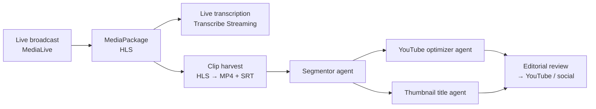

# Aaraf Ali

### Generative AI & Agentic AI Engineer · Full-Stack & Serverless Software Engineer

**Python · TypeScript · LangGraph · LangChain · CrewAI · FastAPI · Node.js · MERN · AWS Serverless**

📧 [aaraf5400@gmail.com](mailto:aaraf5400@gmail.com) &nbsp;·&nbsp; 💼 [LinkedIn](https://linkedin.com/in/aaraf-ali-277588297) &nbsp;·&nbsp; 🐙 [GitHub](https://github.com/aarafbhaijan) &nbsp;·&nbsp; 📍 Thane, Mumbai, India (open to relocation)

 

---

## Professional summary

Generative AI and Agentic AI engineer with nearly **3 years of software engineering experience**, building LLM applications, RAG pipelines and multi-agent systems and running them in production. My primary languages are **Python** and **TypeScript**, and I'm a hands-on **full-stack engineer** underneath the AI work.

- **GenAI & Agentic AI:** I took **NDTV Profit's** multi-agent media platform from proof of concept to production on **AWS Bedrock**, and I'm building an **Azure AI Foundry agent with tool calling** for **Axis Bank**. I work with **LangChain and LangGraph**, and I'm currently building with **CrewAI**.
- **Backend:** production services in **Python (FastAPI, Pydantic)** and **Node.js (Express, TypeScript)**: REST APIs, microservices, event-driven workflows, schedulers and job queues.
- **Full stack (MERN):** end-to-end products with **MongoDB, Express, React and Node.js**, plus **Next.js**. That includes 10+ shipped fintech products and a team-lead role.
- **Databases:** **PostgreSQL** (and Aurora, pgvector), **MySQL**, **MongoDB**, **DynamoDB** and **Redis**, covering schema design, migrations, indexing, transactions and vector search.
- **AWS & serverless:** AWS is my cloud platform. I build serverless, event-driven systems with **Lambda, API Gateway, DynamoDB, S3, EventBridge, SNS, SQS, Cognito, CloudWatch and IAM**, defined as code with **AWS CDK**, and I run containers on **EKS**.

---

## Core skills

| Area | Technologies |
|---|---|
| **Languages** | &nbsp;&nbsp;&nbsp;&nbsp; Python, TypeScript, JavaScript (ES2023), SQL, Bash |
| **Generative AI & LLMs** | &nbsp;&nbsp;&nbsp;&nbsp; LLM application development, prompt engineering, structured outputs, tool / function calling, streaming (SSE), LLM cost & latency tracking · AWS Bedrock (Claude Sonnet), Azure AI Foundry, Groq, Ollama |
| **Agentic frameworks** | &nbsp;&nbsp;&nbsp; **LangChain**, **LangGraph**, **CrewAI** *(currently working with)* · multi-agent orchestration, planner & specialist agents, human-in-the-loop, checkpointing, MCP |
| **RAG & retrieval** | &nbsp;&nbsp; Chunking, embeddings, **pgvector**, Pinecone, hybrid dense + lexical search, reciprocal rank fusion, cross-encoder reranking |
| **LLM evaluation & LLMOps** | &nbsp;&nbsp; Recall@10, MRR, faithfulness, p50/p95 latency, fixed eval sets, CI quality gates, OpenTelemetry tracing |
| **Backend** | &nbsp;&nbsp;&nbsp;&nbsp;&nbsp;&nbsp;&nbsp; **FastAPI**, Pydantic, **Node.js**, **Express**, REST APIs, microservices, event-driven architecture, job queues, cron schedulers, OAuth 2.0 + PKCE, JWT, Zod, pytest, Jest |
| **Frontend** | &nbsp;&nbsp;&nbsp;&nbsp;&nbsp; **React**, **Next.js** (App Router), Redux Toolkit, Ant Design, Tailwind CSS, shadcn/ui, hls.js, react-konva, Web Audio API |
| **Full stack** | &nbsp;&nbsp;&nbsp;&nbsp; **MERN** (MongoDB, Express, React, Node.js), Next.js full-stack apps, payment-gateway integrations, idempotent webhooks |
| **Databases** | &nbsp;&nbsp;&nbsp;&nbsp;&nbsp;&nbsp;&nbsp; **PostgreSQL**, Aurora PostgreSQL, **MySQL**, **MongoDB**, **DynamoDB**, **Redis**, pgvector · Sequelize, Mongoose · schema design, migrations, indexing, transactions |
| **AWS & serverless** | &nbsp;&nbsp;&nbsp;&nbsp;&nbsp;&nbsp;&nbsp;&nbsp;&nbsp; **Lambda**, **API Gateway**, **DynamoDB**, **S3**, **EventBridge**, **SNS**, **SQS**, **Cognito**, **CloudWatch**, **IAM**, **AWS CDK** · EC2, EKS, Aurora, CloudFront, MediaLive, MediaPackage, Transcribe |
| **DevOps** | &nbsp;&nbsp;&nbsp;&nbsp; Docker, Kubernetes (AWS EKS), HPA autoscaling, zero-downtime rollouts, GitHub Actions, Linux |
| **Computer vision & media** | &nbsp;&nbsp;&nbsp; YOLOv8, ByteTrack, MediaPipe, OpenCV, Whisper, FFmpeg |

---

## Experience

### Software Engineer · Applied Cloud Computing
*August 2025 – Present · Mumbai, India · Clients: NDTV Profit, Axis Bank*  
*Official designation: Frontend Developer*

 **NDTV Profit: Generative AI platform over an enterprise content archive** · *client engagement; sole engineer from proof of concept to production, with ongoing production support* · [details](#featured-client-projects)
- Built a **generative AI multi-agent system on AWS Bedrock** with **LangGraph and LangChain** that turns a business news channel's broadcast archive into publish-ready content. A planning agent dispatches specialist agents in parallel through typed Pydantic schemas, with session state in PostgreSQL.
- Built the **RAG pipeline** that grounds generation in the archive (chunking, embeddings, pgvector). When dense retrieval alone kept missing relevant passages, I moved it to **hybrid dense and lexical search with reciprocal rank fusion and a cross-encoder reranker**, measured on a fixed evaluation set with Recall@10 and MRR.
- Turned that evaluation into a **CI gate on Recall@10, MRR, faithfulness and p50/p95 latency**, so a chunking or prompt change that lowers retrieval or answer quality fails the build before it reaches production.
- Traced a **production crash loop** to the LLM returning malformed structured output under load. I added schema validation at every agent boundary with per-agent failure isolation, so one bad response now fails a single stage instead of the whole job.
- Automated a **six-stage content workflow** with scheduled jobs, AWS SNS events and atomic job pickup, removing manual hand-offs between stages. The ingestion pipeline runs **ten concurrent live sessions**, with health checks every thirty seconds that restart a stalled session automatically.
- Deployed the platform on **AWS EKS** with horizontal autoscaling, liveness and readiness probes, resource limits and zero-downtime rolling releases, instrumented end to end with OpenTelemetry tracing and structured logging.

 **Axis Bank: Enterprise IT automation platform** · *client engagement; sole engineer for the Python service and data layer*
- Built the **Python FastAPI** service and **Aurora PostgreSQL** data layer behind the bank's device inventory (schema design, migrations, indexing and schema-level isolation), and deployed **four microservices on Kubernetes** with OAuth 2.0 and PKCE.
- Currently exposing those operational APIs to an **Azure AI Foundry agent through tool calling**, so employees can resolve routine device and access requests through an assistant instead of a support ticket. Every call is authorised through **Microsoft Entra ID**, so the agent can act only within the requesting user's own permissions.

**API Orchestration Platform: Python execution service** · *Applied Cloud Computing product built by a larger team; I individually owned one feature end to end*
- Built the Python scripting connector and the execution service behind it: stateless and process-isolated, with time, memory and concurrency limits and halt-on-failure semantics, covered by about 600 lines of pytest.

### Frontend Developer, promoted to Team Lead · Soliteck Digisolutions
*March 2024 – August 2025 · Navi Mumbai, India · Fintech*  
*Intern March – May 2024 · full-time May 2024 – August 2025 · Team Lead from April 2025*
- **Built a full-fledged fintech product from scratch**, owning the frontend end to end: architecture, the component system, state management and API integration.
- **Made the key design and technical decisions** for the UI: the framework and project structure, design patterns, coding standards and the review process.
- **Built and deployed the product on the company's own infrastructure**, taking it from first commit to production.
- **Promoted to Team Lead** in April 2025, within a year of going full-time. I **led the UI team**, ran code reviews and **mentored junior developers**.
- Shipped **10+ fintech products** (including Soliteck Pay and Rio-Money Pay) in **Next.js, React and TypeScript** against C#/.NET service APIs.
- Integrated **5 payment gateways** (PhonePe, Razorpay, BillAvenue, GoPay and UnLimit Pay) with idempotent webhooks and reconciliation, so a callback delivered twice can't create a duplicate transaction.

---

## Featured client projects

###  NDTV Profit: GenAI & Agentic AI media automation platform
*Applied Cloud Computing · proof of concept → production · backend, AI pipeline and editor UI*

NDTV Profit is one of India's leading business news broadcasters. The platform records the live broadcast, transcribes it, cuts it into stories and has a team of AI agents write the YouTube titles, descriptions, hashtags and thumbnail text, ready for an editor to approve and publish. Work that took hours now takes minutes, with no human step until review.

**Stack:** AWS Bedrock (Claude Sonnet 4.5) · LangGraph · LangChain · RAG · pgvector · Node.js · TypeScript · Express 5 · MySQL · AWS MediaLive · MediaPackage · Transcribe · SNS · S3 · FFmpeg · EKS · Next.js · React · hls.js

- **3-stage multi-agent pipeline:** a **segmentor agent** splits a 15-minute to 3-hour broadcast into stories with full timecode coverage. A **YouTube optimizer** and a **thumbnail title** agent then run **in parallel** for every segment, each producing 4 options.
- **Prompt and schema engineering over 4 iterations:** strict JSON output, a self-correcting gap check, segment targets scaled to video length and interview-integrity rules. Together they fixed over-segmentation, zero-segment results and timecode gaps.
- **Live transcription at scale:** up to **10 concurrent sessions**. FFmpeg streams 16 kHz audio straight into AWS Transcribe Streaming, with silence keep-alives that beat the 15-second idle timeout, and health checks that restart a stalled session automatically.
- **6-phase harvest pipeline:** a MediaPackage harvest job, HLS → MP4 → MP3 with FFmpeg, then batch transcription with SRT output. It runs on an idempotent state machine driven by SNS events and pollers.
- **Unattended scheduling:** a database-backed cron scheduler starts and stops channels, recording and transcription on weekly schedules, with atomic execution and retries.
- **Editor UI built from scratch:** a canvas multi-track timeline (react-konva), HLS playback, a Web Audio waveform, frame-accurate trims, a streaming AI chat assistant (SSE) and one-click publishing to YouTube, Instagram, LinkedIn and X.

###  Axis Bank: Agentic AI IT assistant & automation platform
*Applied Cloud Computing · regulated banking · sole engineer for the Python service and data layer*

An internal platform that lets the bank's IT support staff diagnose and fix employee machines in real time, now being extended with an **AI agent** so employees can solve routine requests themselves.

**Stack:** Azure AI Foundry · tool calling · Microsoft Entra ID · Python · FastAPI · Aurora PostgreSQL · OAuth 2.0 + PKCE · AWS EKS · Kubernetes · Next.js · .NET · SignalR

- **Agent with tool calling:** the bank's operational APIs become callable tools, so an employee resolves a routine device or access request by asking an assistant instead of raising a ticket.
- **Permission-safe by design:** every tool call runs on the requesting user's scoped Entra ID credentials, so the agent can never act beyond that user's permissions.
- **4 production microservices on EKS:** a Next.js console, an ASP.NET Core orchestrator with a SignalR hub, and the FastAPI inventory service and its UI. They use path-based ALB ingress and HPA autoscaling.

---

## Featured personal projects

###  Clipora AI: GenAI & Agentic AI video editor
**[Backend repo](https://github.com/aarafbhaijan/Clipora-GenAI-AgenticAI-Backend) · [Frontend repo](https://github.com/aarafbhaijan/Clipora-GenAI-AgenticAI-Frontend)** · *sole author*

Chat with an agent to turn long videos into short vertical clips. The agent plans the clips, frames whoever is speaking and exports the result.

> 💡 **Inspired by the NDTV Profit platform above.** After building that agentic pipeline for a news broadcaster, I built my own take on the same media use case for creators: you upload a video (or paste a YouTube link) and **direct the agent through chat**. It runs on open models (Groq, Ollama) as well as AWS Bedrock, and adds computer vision so the crop follows whoever is speaking.

**Stack:** Python · FastAPI · LangGraph · PostgreSQL · pgvector · YOLOv8 · ByteTrack · MediaPipe · Whisper · FFmpeg · Next.js · TypeScript · Ant Design

- **Provider-agnostic LLM layer** over AWS Bedrock, Groq and Ollama, switched by configuration, with token usage and cost recorded for every call.
- **LangGraph edit agent** that plans clips, asks for your input when needed and resumes after a restart, with checkpoints stored in Postgres.
- **Hybrid RAG in one PostgreSQL table:** 384-dimension embeddings and a full-text index on the same row, over speaker-labelled Whisper transcripts.
- **Speaker tracking with computer vision:** YOLOv8 detection, ByteTrack tracking, MediaPipe mouth movement and audio energy together find the active speaker and reframe video to 9:16.
- **Production-style plumbing:** Postgres job-queue workers for ingest, agent runs and export, YouTube import and frame-accurate FFmpeg export.

### 🎟️ Seat Reservation Service: Node.js backend
**[Repository](https://github.com/aarafbhaijan/seat-reservation-service)** · deployed on AWS EC2

A JSON API that sells assigned seats and stays correct under an on-sale stampede: **no seat is ever sold twice, no user exceeds their limit, and a retried request never books twice.**

**Stack:** Node.js 22 · TypeScript · Express 5 · MySQL 8 · Docker · AWS EC2

- Concurrency-safe booking with idempotent requests, tested under a **20k-request burst** on the deployed service.
- Liveness and readiness probes, a `/metrics` endpoint and structured JSON logs with request IDs.

### ☁️ AWS serverless projects
**Stack:** TypeScript · AWS Lambda · API Gateway · DynamoDB · EventBridge · S3 · Cognito · CloudWatch · IAM · AWS CDK · Jest

- **Energy Intelligence Platform:** a serverless, event-driven platform for managing renewable-energy projects. It uses Lambda, API Gateway, **EventBridge**, **DynamoDB**, S3 presigned uploads and **Cognito** auth, all defined in **AWS CDK**, with dead-letter-queue redrive and 156 unit tests at about 95% coverage.
- **Events Catalog API:** five TypeScript Lambdas behind an API Gateway HTTP API, deployed with CDK, with cursor pagination, Zod validation and handler tests using fake API Gateway events.
- **Todo CRUD API:** a serverless CRUD API on Lambda, API Gateway and DynamoDB.

### 🛠️ Multi-Agent AIOps Copilot *(in progress)*
**Stack:** Python · LangGraph · PostgreSQL · pgvector · Redis · MCP · Ollama

- The service architecture, configuration layer, health endpoints, PostgreSQL schema, CI pipeline and a synthetic generator for telemetry, runbooks and postmortems are built. Agent orchestration, retrieval and remediation are under development.

---

## Education
**B.Sc. Computer Science** · University of Mumbai (B.N. Bandodkar College of Science, Thane) · 2020 – 2023 · CGPA **8.48 / 10**

## Awards
- 🏆 **Best Employee**, Soliteck Digisolutions: Q4 2025
- 🏆 **Best Employee**, Soliteck Digisolutions: Debut Year 2024
- ⭐ **Top 5%**, LinkedIn JavaScript Skill Assessment

---

**Open to GenAI / Agentic AI and full-stack engineering roles.** Let's talk: [aaraf5400@gmail.com](mailto:aaraf5400@gmail.com)

