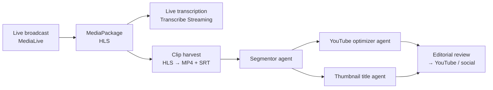

# Aaraf Ali

### Generative AI & Agentic AI Engineer · Python · TypeScript

I build LLM applications, RAG pipelines and multi-agent systems, and run them in production.

---

## About me

I'm a **Generative AI and Agentic AI engineer** with nearly **3 years** of software engineering experience. **Python** and **TypeScript** are my primary languages, and I build backends in both: **FastAPI** on the Python side and **Node.js / Express** on the TypeScript side.

- I took **NDTV Profit's GenAI & Agentic AI media platform** from proof of concept to production: a multi-agent pipeline on **AWS Bedrock**, a **Node.js / TypeScript** media backend on AWS, and deployment on **EKS**.
- I'm building an **Azure AI Foundry agent with tool calling** for **Axis Bank**, so employees can resolve IT requests through an assistant within their own permissions.
- I cover the whole GenAI lifecycle: prompts and schemas, tool calling, retrieval and reranking, evaluation gated in CI, and cost and latency tracking.
- My everyday stack is **LangGraph, LangChain, FastAPI and Pydantic**, with **Next.js / React** when the product needs a front end.

---

## Tech stack

<table>
<tr><td><b>Languages</b></td><td>

</td></tr>
<tr><td><b>Generative AI & LLMs</b></td><td>

-D97757?style=flat&logo=anthropic&logoColor=white)

</td></tr>
<tr><td><b>Agentic AI</b></td><td>

</td></tr>
<tr><td><b>RAG & Retrieval</b></td><td>

</td></tr>
<tr><td><b>LLM evaluation</b></td><td>

</td></tr>
<tr><td><b>Backend</b></td><td>

</td></tr>
<tr><td><b>Frontend</b></td><td>

</td></tr>
<tr><td><b>Data</b></td><td>

</td></tr>
<tr><td><b>Cloud, DevOps & LLMOps</b></td><td>

</td></tr>
<tr><td><b>Computer vision & media</b></td><td>

</td></tr>
</table>

---

## Featured client projects

###  NDTV Profit: GenAI & Agentic AI media automation platform
*Applied Cloud Computing · from proof of concept to production · backend, AI pipeline and editor UI*

NDTV Profit is one of India's leading business news broadcasters. The platform automates their post-production work: it records the live broadcast stream, transcribes it, cuts it into stories, and has a team of AI agents write the YouTube titles, descriptions, hashtags and thumbnail text, ready for an editor to approve and publish. A manual job that took hours now takes minutes, with no human step until review.

`AWS Bedrock (Claude Sonnet 4.5)` `Multi-Agent Orchestration` `LangGraph` `LangChain` `RAG` `pgvector` `Node.js` `TypeScript` `Express 5` `MySQL` `AWS MediaLive` `AWS MediaPackage` `AWS Transcribe` `SNS` `S3` `FFmpeg` `EKS` `Next.js` `React` `hls.js`

- **3-stage multi-agent pipeline on AWS Bedrock.** A **segmentor agent** splits a 15-minute to 3-hour broadcast into stories with full timecode coverage. A **YouTube optimizer agent** and a **thumbnail title agent** then run **in parallel** for every segment, each producing 4 options.
- **Prompt and schema engineering over 4 iterations:** strict JSON output, a self-correcting gap check, segment-count targets scaled to video length and interview-integrity rules. Together they fixed over-segmentation, zero-segment results and timecode gaps.
- **Grounded generation:** RAG over the broadcast archive with hybrid dense and lexical search, reciprocal rank fusion and a cross-encoder reranker, gated in CI on Recall@10, MRR, faithfulness and p95 latency.
- **Live transcription at scale:** up to **10 concurrent live sessions**. FFmpeg streams 16 kHz audio straight into AWS Transcribe Streaming, with silence-packet keep-alives that beat the 15-second idle timeout, and health checks that restart a stalled session automatically.
- **6-phase harvest pipeline:** a MediaPackage harvest job, HLS → MP4 → MP3 with FFmpeg, then batch transcription with SRT output. It runs on an idempotent state machine driven by AWS SNS events and pollers.
- **Unattended scheduling:** a database-backed cron scheduler starts and stops channels, recording and transcription on weekly schedules, with atomic execution and retries.
- **Production hardening:** I traced a Kubernetes crash loop to malformed LLM output and fixed it with schema validation at every agent boundary and per-agent failure isolation. Deployed on **AWS EKS** with autoscaling, probes, zero-downtime releases and OpenTelemetry tracing.
- **Editor UI:** a custom video editor built from scratch, with a canvas multi-track timeline (react-konva), HLS playback (hls.js), a Web Audio waveform and frame-accurate trims. It also has a streaming AI chat assistant (SSE) and one-click publishing to YouTube, Instagram, LinkedIn and X.

###  Axis Bank: Agentic AI IT assistant & automation platform
*Applied Cloud Computing · regulated banking · sole engineer for the Python service and data layer*

An internal platform that lets the bank's IT support staff diagnose and fix employee machines in real time, now being extended with an **AI agent** so employees can solve routine requests themselves.

`Azure AI Foundry` `Tool Calling` `Microsoft Entra ID` `Python` `FastAPI` `Aurora PostgreSQL` `OAuth 2.0 + PKCE` `AWS EKS` `Kubernetes` `Next.js` `.NET` `SignalR`

- **Azure AI Foundry agent with tool calling:** I'm exposing the bank's operational APIs to the agent as callable tools, so an employee can resolve a routine device or access request by asking an assistant instead of raising a support ticket.
- **Permission-safe by design:** every tool call runs on the requesting user's scoped credentials through **Microsoft Entra ID**, so the agent can never act beyond that user's own permissions.
- Built the **Python FastAPI** service and **Aurora PostgreSQL** data layer behind the bank's device inventory (schema design, migrations, indexing, schema-level isolation).
- Deployed **4 production microservices** on **AWS EKS**: a Next.js console, an ASP.NET Core orchestrator with a SignalR hub, the FastAPI inventory service and its UI. The platform uses OAuth 2.0 + PKCE, path-based ALB ingress and HPA autoscaling.

---

## Featured personal projects

###  Clipora AI: GenAI & Agentic AI video editor
**[Backend](https://github.com/aarafbhaijan/Clipora-GenAI-AgenticAI-Backend) · [Frontend](https://github.com/aarafbhaijan/Clipora-GenAI-AgenticAI-Frontend)** · *Personal project, sole author*

Chat with an agent to turn long videos into short vertical clips. The agent plans the clips, frames whoever is speaking and exports the result.

> 💡 **Inspired by the NDTV Profit platform above.** After building that agentic pipeline for a news broadcaster, I built my own take on the same media use case for creators: instead of a scheduled pipeline over a live channel, you upload a video (or paste a YouTube link) and **direct the agent through chat**. It runs on open models (Groq, Ollama) as well as AWS Bedrock, and adds computer vision so the crop follows whoever is speaking.

`Python` `FastAPI` `LangGraph` `PostgreSQL` `pgvector` `YOLOv8` `ByteTrack` `MediaPipe` `Whisper` `FFmpeg` `Next.js` `TypeScript` `Ant Design`

- **Provider-agnostic LLM layer** over AWS Bedrock, Groq and local Ollama, switched by configuration, with token usage and cost recorded for every call.
- **LangGraph edit agent** that plans clips, asks for your input when needed and resumes after a restart, with its checkpoints stored in Postgres.
- **Hybrid RAG in one PostgreSQL table:** 384-dimension embeddings and a full-text index on the same row, searched over speaker-labelled Whisper transcripts.
- **Computer vision speaker tracking:** combines four signals (YOLOv8 detection, ByteTrack tracking, MediaPipe mouth movement and audio energy) to find the active speaker and reframe video to 9:16.
- **Production-style plumbing:** Postgres job-queue workers for ingest, agent runs and export, YouTube import with yt-dlp, and frame-accurate FFmpeg export.
- **Agentic UI:** a VS Code-style editor that shows the agent's plan step by step, a live status bar, a timeline editor and one-click portrait conversion.

### 🎟️ Seat Reservation Service: Node.js backend
**[Repository](https://github.com/aarafbhaijan/seat-reservation-service)** · [Live demo](https://16-178-3-167.sslip.io/healthz)

A JSON API that sells assigned seats and stays correct under an on-sale stampede: **no seat is ever sold twice, no user exceeds their limit, and a retried request never books twice.**

`Node.js 22` `TypeScript` `Express 5` `MySQL 8` `Docker` `AWS EC2`

- Concurrency-safe booking with idempotent requests, tested under a **20k-request burst** on the deployed service.
- Liveness and readiness probes, a `/metrics` endpoint and structured JSON logs with request IDs.

### 🛠️ Multi-Agent AIOps Copilot *(in progress)*
`Python` `LangGraph` `PostgreSQL` `pgvector` `Redis` `MCP` `Ollama`

- The service architecture, configuration layer, health endpoints, PostgreSQL schema, CI pipeline and a synthetic generator for telemetry, runbooks and postmortems are built. Agent orchestration, retrieval and remediation are under development.

### More on GitHub
| Project | Stack |
|---|---|
| [Pixel-Playtoon-App](https://github.com/aarafbhaijan/Pixel-Playtoon-App) | Next.js · TypeScript game application |
| [PharmaSift](https://github.com/aarafbhaijan/PharmaSift) ([live](https://pharmasift.vercel.app/)) | React web application |
| [AntDNav](https://github.com/aarafbhaijan/AntDNav) | Next.js · Ant Design navigation |
| [Shadcn-Ui](https://github.com/aarafbhaijan/Shadcn-Ui) | Next.js · shadcn/ui components |
| [TBE-Web](https://github.com/aarafbhaijan/TBE-Web) | Contributions to The Boring Education web app |

---

## Experience

### Software Engineer · Applied Cloud Computing
*August 2025 – Present · Mumbai, India · Clients: NDTV Profit, Axis Bank*

 **NDTV Profit: Generative AI platform over an enterprise content archive** (sole engineer, from proof of concept to production · [details](#featured-client-projects))
- Built a **generative AI multi-agent system** on **AWS Bedrock** with **LangGraph and LangChain** that turns a business news channel's broadcast archive into publish-ready content. A planning agent dispatches specialist agents in parallel through typed Pydantic schemas, with session state in PostgreSQL.
- Built the **RAG pipeline** that grounds generation in the archive (chunking, embeddings, pgvector). When dense retrieval alone kept missing relevant passages, I moved it to **hybrid dense and lexical search with reciprocal rank fusion and a cross-encoder reranker**, measured with Recall@10 and MRR.
- Turned that evaluation into a **CI quality gate** on Recall@10, MRR, faithfulness and p50/p95 latency, so a prompt or chunking change that lowers quality fails the build before it reaches production.
- Traced a production crash loop to malformed structured LLM output under load. I added **schema validation at every agent boundary** with per-agent failure isolation, so one bad response now fails a single stage instead of the whole job.
- Automated a **six-stage content workflow** with scheduled jobs, AWS SNS events and atomic job pickup. The ingestion pipeline runs ten concurrent live sessions with self-healing health checks.
- Deployed on **AWS EKS** with autoscaling, liveness and readiness probes, and zero-downtime rolling releases, traced end to end with **OpenTelemetry**.

 **Axis Bank: Agentic AI IT assistant & automation platform** (sole engineer for the Python service and data layer)
- Built the **Python FastAPI** service and **Aurora PostgreSQL** data layer behind the bank's device inventory, and deployed four microservices on Kubernetes with **OAuth 2.0 and PKCE**.
- I'm currently exposing those APIs to an **Azure AI Foundry agent through tool calling**, authorised through Microsoft Entra ID, so the agent can act only within the requesting user's own permissions.

**API orchestration platform: Python execution service**
- Owned the Python scripting connector and its execution service end to end: stateless and process-isolated, with time, memory and concurrency limits, and covered by about 600 lines of pytest.

### Frontend Developer → Team Lead · Soliteck Digisolutions
*March 2024 – August 2025 · Navi Mumbai, India · Fintech*
- **Promoted to team lead** in April 2025. I owned front-end architecture, code reviews and coding standards, and mentored developers early in their careers.
- Built **10+ fintech products**, including Soliteck Pay and Rio-Money Pay, in **Next.js, React and TypeScript** against C#/.NET service APIs.
- Integrated **five payment gateways** (PhonePe, Razorpay, BillAvenue, GoPay and UnLimit Pay) with idempotent webhooks and reconciliation.

---

## Education
**B.Sc. Computer Science** · University of Mumbai (B.N. Bandodkar College of Science, Thane) · 2020 – 2023 · CGPA **8.48 / 10**

## Awards
- 🏆 **Best Employee**, Soliteck Digisolutions: Q4 2025
- 🏆 **Best Employee**, Soliteck Digisolutions: Debut Year 2024
- ⭐ **Top 5%**, LinkedIn JavaScript Skill Assessment

---

**Open to GenAI / Agentic AI engineering roles.** Let's talk: [aaraf5400@gmail.com](mailto:aaraf5400@gmail.com)

